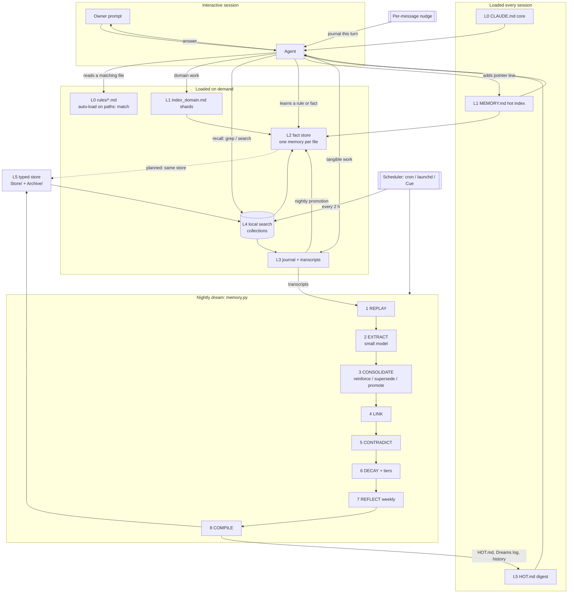
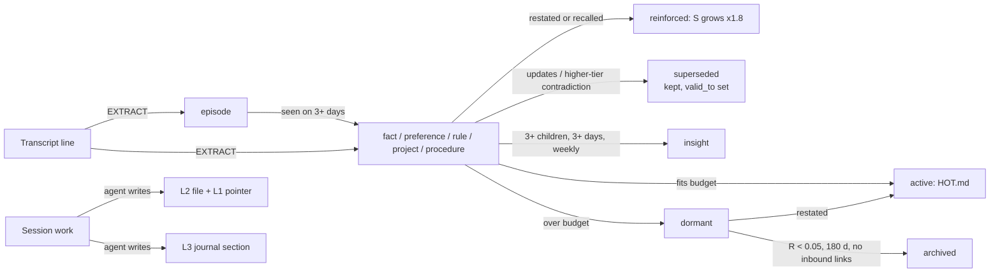

# Multi-Layer Agent Memory: Architecture

Spec version: 2026-11-11.2

A memory system for a long-lived Claude Code agent that works inside a markdown notes vault (Obsidian or any
folder of `.md` files). It has seven layers. Each layer has one job, one store, and its own off switch.

The design rests on one law: **the vault is the database.** Every layer is plain markdown or a derived index of
plain markdown. Nothing holds facts that the files do not hold. A human can read, edit, sync and version every
memory in a normal editor.

## 1. The Layers

| Layer | Name | Stores | Loaded | Written by | Status in our system |
|---|---|---|---|---|---|
| **L0** | Instructions | `CLAUDE.md` core + path-scoped `rules/*.md` | Core: every turn. Rules: when the agent reads a file that matches the rule's `paths:` globs | Owner and agent, by hand | Live |
| **L1** | Hot index | `MEMORY.md`: one line per memory, plus `index_<domain>.md` shards | Every session, by the harness (byte limit) | Agent, when it adds a memory | Live, hand-sharded |
| **L2** | Fact store | One memory per file, typed, with front matter and `[[links]]` | On demand, when an index line points at it | Agent, during a session, and the nightly promotion job (`memory_promote.py`) | Live; one store for all accounts via symlinks; nightly lint (`memory_lint.py`) |
| **L3** | Episodic log | Daily journal `Journal/YYYY-MM-DD.md` with a `Summary::` field and per-section session markers; raw session transcripts | Recent days at session start; older days by search | Agent, after something tangible happens | Live |
| **L4** | Search | Local hybrid search (BM25 + vectors + rerank) over separate collections | On demand | A scheduled re-index (every 2 h) | Live |
| **L5** | Consolidation ("dream") | Typed memory records with decay state, a compiled hot digest, a dream log | Nightly batch; digest injected into the prompt | `memory.py dream`, nightly | Live in one agent since 2026-11-06; not yet over the main L2 store |
| **L6** | Hooks | Per-turn capture and injection | Every turn | Harness hooks | Optional. Capture does not depend on it (section 3, Capture) |

Cross-cutting: **enforcement ledgers.** A rule that must never be broken does not live only in prose. It lives in
a small tool that refuses (for example, a "recommend once, ever" ledger that rejects a repeat entry). Prose
instructions are advisory. Code that says no is the only enforcement that holds across many sessions.

## 2. Data Flow

**Write paths.** During a session the agent writes three things: a fact or rule into L2 (one file), a pointer
line into L1, and a dated journal section into L3. At night the dream reads L3 transcripts and writes L5.
A nightly promotion job (`memory_promote.py`) reads L3 and writes L2, so a durable fact no longer depends on the
agent noticing it in the moment.

**Read paths.** L0 core, L1 and the L5 digest are in context before the first prompt. Everything else is pulled:
L0 rules by file-path match, L1 shards by domain, L2 files by pointer, L3 and L4 by search.

## 3. Layer Details

### L0: Instructions with Progressive Disclosure

- `CLAUDE.md` is the always-on core. Every byte costs context on every turn, so it has a budget (18 KB).
  Each rule there is a short trigger plus a pointer.
- The full rule, its evidence and its history live in `rules/<topic>.md`. Each rules file starts with `paths:`
  globs. Claude Code loads that file automatically the first time the agent reads a file that matches.
- `claude_md_audit.py` enforces the budget and finds dead imports, dead paths, dead scopes and orphan rules files.
- See `CLAUDE.md.fragment.md` and `rules-example.md`.

### L1: Hot Index

- `MEMORY.md` sits next to the store and the harness loads it into every session. **It has a hard load limit.**
  On our harness version, content past about 24.4 KB did not load. Nothing warns you: the tail just disappears.
- One line per memory: `- [Title](file.md): hook`. No memory content in the index.
- When the index grows, split it by domain: `MEMORY.md` keeps the core lines plus one pointer per shard
  (`index_travel.md`, `index_tooling.md`, ...), with a "read when touching X" trigger. This took our index from
  over the limit to about 14 KB over 228 memories.
- `memory_index_check.py` fails when the index is over budget, a pointer is dead, a memory is unindexed, or a
  shard is unreachable.

### L2: Fact Store

- One memory per file, YAML front matter, a typed body. Types: `user`, `feedback`, `project`, `reference`.
  Feedback and project memories carry `**Why:**` and `**How to apply:**` lines, because a rule without its reason
  gets applied in the wrong place. See `harness-memory-format.md`.
- Related memories link with `[[slug]]`. A dangling link is allowed: it marks a memory worth writing later.
- **Residency.** The harness keys memory on (config dir) x (project cwd). An agent that rotates between accounts
  forks its memory on every switch. `link_store.py` points every config dir's memory path at one folder inside
  the vault. The vault becomes the system of record with zero harness changes.
- Before saving, the agent checks for an existing file on the same topic and updates it. Wrong memories are
  deleted. Facts the repo already records (code, git history) are not saved.

### L3: Episodic Log

- `Journal/YYYY-MM-DD.md`, one per day, with a `Summary::` field at the top that is rewritten as the day grows.
  Earlier sections are never removed.
- **Per-section attribution.** Several sessions write the same day file. Each `##` section gets a marker on the
  line under its heading: an HTML comment (invisible when rendered) with the session's stable tab ID, its
  transcript ID and a timestamp, plus an optional deep link back to the session. A day-level "written by" line
  lost a write race in practice; per-section markers do not.
- At wake-up the agent reads the last few days. Older days are reached through L4.
- Raw session transcripts (the harness JSONL) are the other half of L3. They feed L5.

### Capture Without Hooks

Not every harness has lifecycle hooks, so capture must not depend on them. Ours runs on two things any setup has:
a message and a scheduler.

| Source | Trigger | What lands |
|---|---|---|
| Journal (L3) | A standing nudge appended to every user message ("journal what happened") by the orchestrator | One stamped section per piece of work |
| Turn history | The orchestrator records every turn | Full turns, searchable by date and text |
| Screen and keyboard history | OS accessibility capture (local only) | What the owner saw and typed outside the agent |
| Activity recorder | Daily scheduled ingest | Decisions, commitments, meetings per day |
| Recordings | Scheduled harvest | Meeting and voice transcripts |

**The gap is promotion, not capture.** Everything above lands in L3. Nothing moves it into L2 except the agent
deciding to, in the moment. A cleanup job (dead references, verbatim duplicates, expired facts, index budget) is
not a promotion job. The fix is **`memory_promote.py`**, run by the scheduler, not a hook:

1. **Replay** one day: the journal (session markers stripped), the orchestrator's turn history, and the activity
   recorder's decisions for that day. Each source is optional.
2. **Extract** with one model call. The prompt carries the whole store catalog (slug, type, description), so the
   model proposes an update to an existing memory instead of a duplicate.
3. **Validate**: drop malformed items, items without a supporting quote, updates to unknown slugs, off-limits
   topics (a regex in config), and anything over the nightly cap (8).
4. **Write** (apply mode only): new files in harness format carrying `said_by`, `sources`, `learned`, `promoted`,
   plus decision fields when the item settles a question; a pointer in the matching section index (fallback
   `index_promoted.md`, which the weekly audit re-homes). An update appends a dated paragraph. Nothing is
   deleted or rewritten.
5. **Log** every proposal and result to `Memory/Promotions/<day>.md`, in both modes.

It runs in dry-run (proposals to the log, store untouched) until a date in config (`promote.apply_after`) has
passed; that window is the safety period. Review is off by default; with `promote.require_review: true` the gate
also waits for `promote.reviewed: true`. Every path to apply obeys the gate; an explicit apply against a closed gate
exits 3. Apply also needs the promoted shard and a `MEMORY.md` pointer to it, or it exits 2 having written
nothing. Before the model call every source is redacted: off-limits lines and credential lines are replaced by
markers, so they never leave the machine. A source that cannot be read at all (no Maestro CLI, a failed
command) is logged as skipped with its reason, not as empty. The model CLI, the journal layout and the CLI path
are config keys, so no file needs patching for another harness. The store folder is a config key too
(`store_dir`, default `Store`, `.` for flat); it is never guessed from what exists on disk. Every proposal's quote is checked against that day's sources; one that is not there is dropped as
`unquoted`. Each applied day is recorded, so a re-run never applies a day twice. First dry-run on a real day (16 K chars of journal,
10 K of turn history, 1.5 K of decisions): 5 proposals in 30 s, each backed by a quoted line, 2 of them updates.

**Nightly lint, no model** (`memory_lint.py`, right after promotion):

- **Dead references.** Every backticked path a memory names must exist. Placeholders (`YYYY`, `<x>`) and paths the
  memory itself calls retired or moved are skipped. A memory whose paths all resolve gets `verified: <date>`,
  re-stamped at most monthly so sync churn stays low.
- **Decision records.** `decision: true`, `status: active|superseded`, `supersedes`, and a machine-checkable
  `reopen_if`: `after:YYYY-MM-DD`, `exists:<path>`, `grep:<path>::<regex>`, or `manual:<words>`. A condition that
  fires is stamped `reopen_fired` once and raised as one notification. This is what stops a parked decision from
  either being re-recommended by accident or never being revisited.
- **Index integrity** (unindexed memories, dead pointers, core index size) and **coverage** (`said_by`, `sources`,
  `verified`), written to a health page that is overwritten each run.

**Weekly smoke test** (`memory_smoke.py`): fixed questions in `smoke.json`. `expect` questions name the memory that
must answer; `abstain` questions must not be answerable. Lexical recall takes the top 5, then a yes/no judge decides
whether they actually state the answer. Word overlap alone cannot abstain ("blood type" matches a memory about
large type), so the judgment cannot be a score threshold. The judge's reply is read for the first line that is
only YES or NO; labels and footers on other lines are ignored, and a reply with no such line counts as a miss for
both kinds of question. Gate: answers at least 80% right and at least 3 correct refusals.

**Switches.** `Memory/config.json` holds `enabled`, `readonly` and one block per job. `AGENT_MEMORY=0` or a
`Memory/.disabled` file beats the config. A transient failure (the model call, a missing source) exits 0 with a
log line: a bad night costs a night of promotion, never a broken session. A setup error or a closed review gate
exits non-zero (2 or 3) so the scheduler sees it, and writes nothing.

**Protected files belong in the job runner, not a hook.** Before a background job runs, the runner snapshots the
identity and instruction files (`CLAUDE.md`, `rules/`, the owner persona). After it runs, whatever the outcome, the
runner restores any changed or deleted file, moves aside any new one, keeps the job's version as `<name>.rejected`,
and logs each undo. Background jobs suggest changes to who the agent is; they never make them. A job whose purpose
is to edit those files (an instructions-budget audit) opts out with a flag. `protected_files.py` is the whole
mechanism: `snapshot()` before, `restore(snap)` after.

### L4: Search

- A local, on-device hybrid search engine (we use [qmd](https://github.com/tobi/qmd): BM25 + vectors + LLM
  rerank). Any local index works if it has keyword and semantic modes and named collections.
- **Split the agent's own memory into its own collections** (`agent-journal`, `agent-tools`, `agent-tasks`, ...)
  apart from the owner's content collections. Recall can then target "what have I done before" without wading
  through articles and transcripts.
- Embeddings key on content hash, so moving files between collections costs almost nothing.
- Re-index on a schedule (`qmd-update.sh`, every 2 h).
- Search the tools collection before claiming a capability does not exist.

### L5: Consolidation (the Dream)

The reference implementation is `memory.py` (stdlib only, one file, tested by `test_memory.py`).

**Record.** See `memory-record.schema.json`. Files hold states; a file is rewritten only on a state change or a
reinforcement, so sync churn stays low.

**Decay.** Retrievability, with Δt = days since `last_reinforced`:

$$R = e^{-\Delta t / S}, \qquad S = S_0(\text{type}) \times \min\left(1.8^{\,n},\ 10\right)$$

where n is the reinforcement count. Recall is rehearsal: each recall, and each restatement in a later session,
adds one reinforcement (at most one per memory per day), so used memories live longer.

| Type | S₀ (days) | Why |
|---|---|---|
| episode | 14 | Pointers to "that session where X"; the episode file itself never decays |
| project | 45 | In-flight work goes stale fast |
| fact | 180 | People, tools, systems |
| insight | 270 | Re-earned weekly by REFLECT if still true |
| preference, reference, procedure | 365 | Change slowly |
| **rule** | **∞** | **Never decays.** A weakly recalled rule is a repeat offense. Rules exit only by supersession |

**Tiers.**

| Tier | Condition | Effect |
|---|---|---|
| active | Fits the hot byte budget, ranked rule/pinned, then salience, then R | In `HOT.md`, injected into the prompt |
| dormant | Did not fit the budget | Still recallable; one restatement reactivates it |
| archived | R < 0.05 AND 180 days untouched AND no inbound links | File moves to `Archive/`, out of default recall |
| superseded | Replaced by a newer memory | Kept, with `superseded_by` and `valid_to` |

**Nothing is ever deleted.** Demotion is a rank change and a folder move. Only a hand-run `purge` deletes.

**Rules take at most half the hot budget.** Rules are exempt from decay and archival, not from the budget. An
index that overflows its cap is the silent-truncation failure this layer exists to kill.

**Dream phases, in fixed order** (repair files first, derive indexes second, report last):

1. **REPLAY**: read sessions not yet replayed. Only the owner's words and task results; assistant lines as
   context; unattributed speech never.
2. **EXTRACT**: one small-model call per 22 K-char chunk, budget-capped (default 14 calls). Returns candidate
   memories with a relation to an existing slug: `new`, `same:`, `updates:`, `contradicts:`. A sensitive-topic
   filter drops candidates unread. **Each candidate must quote 3 or more words from one owner turn or one
   task-result turn**; assistant text never counts. The quote, not the model, sets `said_by`. Unquoted
   candidates are dropped and counted (`SESSION-FORMAT.md` has the input contract).
3. **CONSOLIDATE**: `same` (or lexical similarity ≥ 0.78) reinforces. `updates` supersedes. An `episode` seen on
   3+ distinct days is **promoted** to `fact` (episodic to semantic).
4. **LINK** (A-MEM): every memory touched tonight links to its 3 nearest neighbours, both directions.
5. **CONTRADICT**: a contradiction supersedes only if it is newer AND from an equal or higher source tier
   (`owner` > `task` > `inferred`). Otherwise both stay and the dream log flags it.
6. **DECAY**: recompute R, assign tiers, log every tier change.
7. **REFLECT** (weekly): one model call over the week's memories. An insight is kept only with 3+ children from
   3+ distinct days; children and insight link both ways (provenance).
8. **COMPILE**: `HOT.md`, `history.jsonl` (one row per night for graphs), `Dreams/<date>.md` (every change, with
   its reason, so a wrong demotion is diagnosable and reversible).

**Switches.** `config.json` holds `enabled`, `readonly` (freeze: recall works, nothing writes) and one flag per
phase. `AGENT_MEMORY=0` or a `.disabled` file beats the config. Every path is fail-open: an error means
"no memory", never a broken session. OFF means exactly the behavior you had before the layer existed.

### L6: Hooks (optional)

Use hooks where a harness has them and a cold-start surface needs injection. Capture never depends on them
(see Capture Without Hooks).

Four harness events, patterned on a production memory engine's hook contract:

| Event | Action | Limit |
|---|---|---|
| SessionStart | Inject the compiled digest | ≤ 8 KB, deterministic, no model call |
| UserPromptSubmit | Inject the top recall hits for this prompt | ≤ 8 KB, deterministic |
| Stop | Queue the turn for the next dream | No model call |
| SessionEnd | Copy the transcript into the session folder (secret-scanned) | None |

Contract: fail-open, a kill switch env var, no model call on the hot path, logs carry codes, never content.
Build it first where sessions are cold starts with no human to re-explain context (a message bus, a scheduled
job). Build it last for interactive sessions, where the agent can read the index and search by itself.

## 4. Recall

Three tiers. The agent never has to pick a backend per question.

| Tier | Surface | Cost | Answers |
|---|---|---|---|
| T0 | `MEMORY.md` + `HOT.md`, already in context | Free | Rules, top preferences, active projects. Most turns stop here |
| T1 | `memory.py recall "<q>"`, then index pointers into L2 | One local call | Anything about the owner, the agent, past decisions, "have I done this before" |
| T2 | L4 search over content collections | One local call | Articles, transcripts, research. Memory state does not matter |

T1 scoring in `memory.py`: idf-weighted lexical match (0.72) + subject adjacency when the question names a known
subject (0.22) + R as a tie-breaker (0.06). The two strongest hits pull in their linked neighbours one hop out.

**When T1 comes back thin, widen to T2.** A routing mistake should cost latency, never the answer.

**The abstain contract.** No hit means "say you do not remember; never guess." `recall_line()` puts that sentence
into the prompt. Confident wrong negatives and confident inventions are the costliest failures a memory has.

## 5. Promotion Paths

## 6. What We Measured (and changed because of it)

- **Absolute decay thresholds were inert.** On a 122-file store, every memory scored R ≥ 0.92; seven variants of
  the constants produced zero demotions. The real scarcity is the byte budget, so the active tier is a
  budget-ranked cut, and the absolute floor is used only for archival.
- **A static weighted score lost to plain lexical search** in a 30-question backtest (hit@3 0.967 lexical vs
  0.867 weighted; MRR 0.818 vs 0.757). Only the graph-adjacency term earned its weight. R and salience became
  tie-breakers.
- **File mtime is not reinforcement.** 31 memories had all their apparent recency from bulk-edit artifacts.
  Reinforcement counts only real touches: a recall, or a restatement extracted by the dream.
- **Chunked vector search misses structured fields.** CamelCase front-matter keys did not tokenize, so a known
  answer sitting in the corpus never surfaced. Keep exact-field lookups (grep, a Dataview-style query) beside
  semantic search.
- **An external memory engine became a second system of record.** A trial of a mature open-source engine was
  well engineered, but most of its value needed a model key per turn, and it wanted to own its own store outside
  the vault. We kept the vault-native design and copied its hook contract (L6).

## 7. Known Gaps

- T1 recall is lexical. A paraphrase that shares no word with the memory misses: "what does Alex drink" does not
  find "Alex prefers tea over coffee". This is why a thin T1 result must widen to T2 semantic search.
- L5 (the dream) runs over its own store. The promotion job covers the main L2 store instead, with no decay: the
  byte budget, enforced by the index check and the weekly audit, is the only pressure on L2 today.
- `MEMORY.md` is still maintained by the agent and the audit, not compiled from a policy.
- Promotions after the gate are reviewed by a weekly model audit, not by a human. No human sign-off is required
  by default; the dry-run window before `apply_after` is the chance to read proposals, and a later spot check of
  what was written replaces the sign-off. `promote.require_review: true` restores a sign-off at the gate.
- `said_by` exists only where it could be backfilled from a direct quote, and on everything promoted since.
- The harness writes loose YAML (unquoted colons in descriptions). Strict parsers silently skip those files: we
  found 5 of 230 memories invisible to every tool. `memstore.py` parses leniently, the way the harness does.
